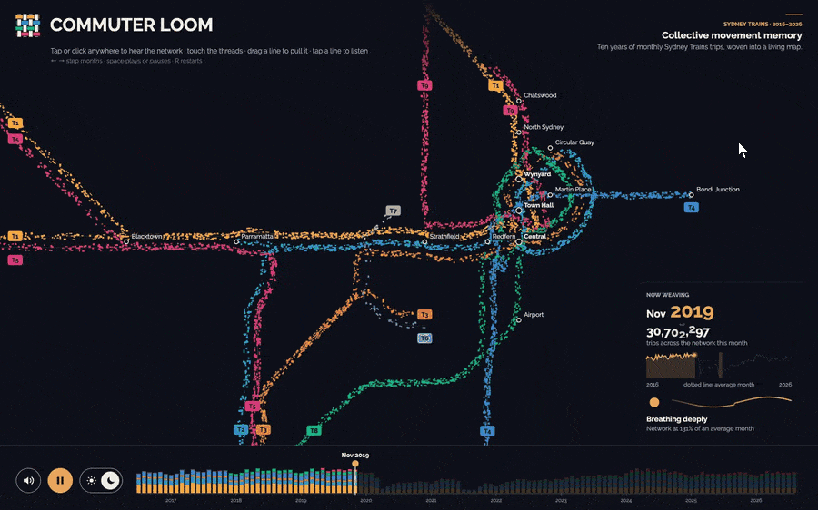
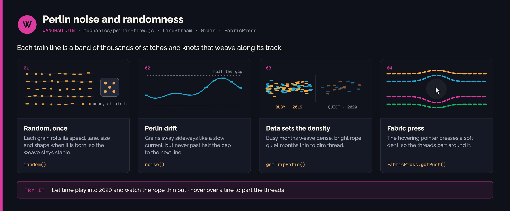
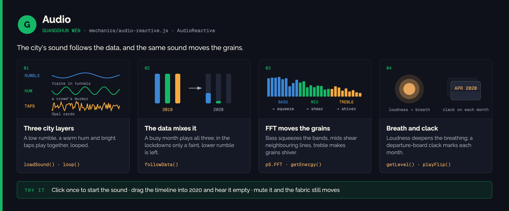
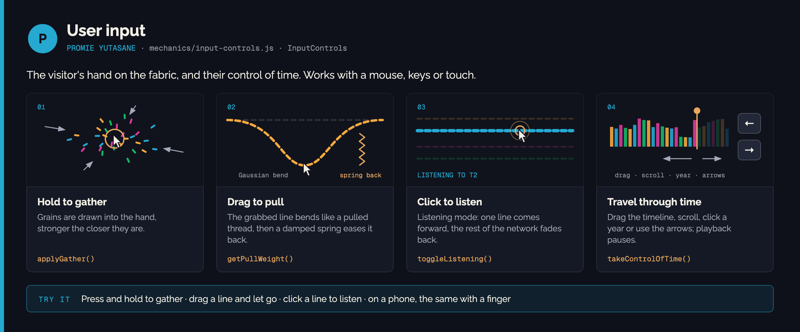
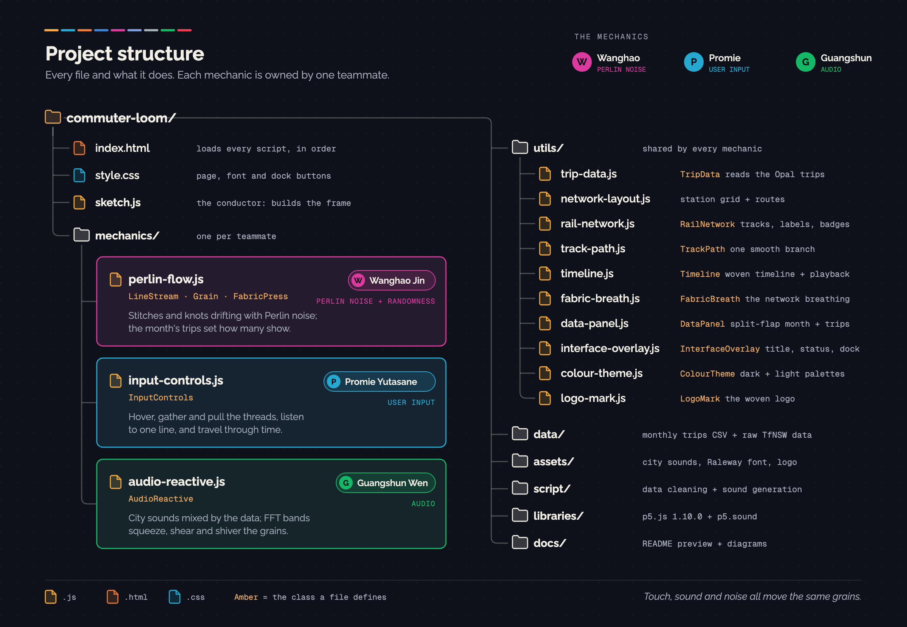
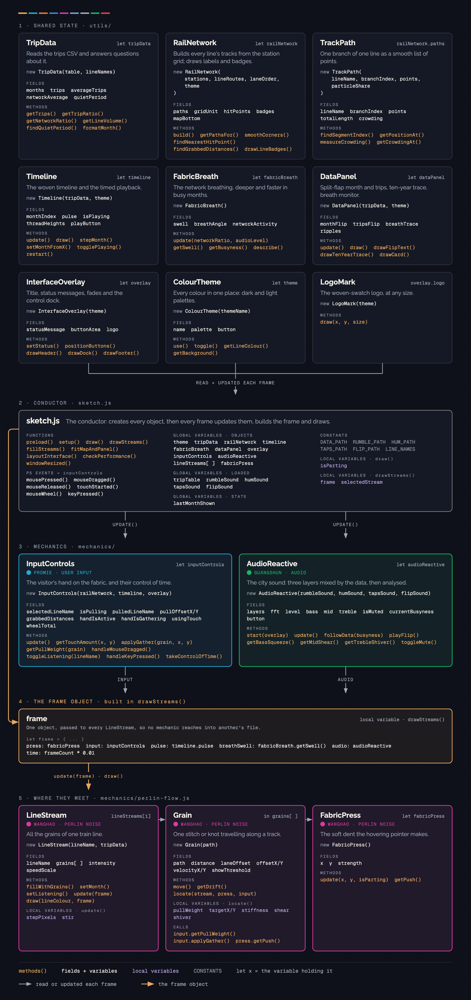
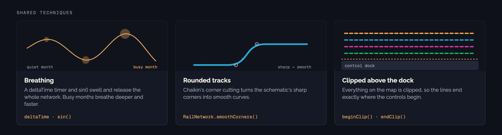

# Commuter Loom

*Commuter Loom: Collective Movement Memory* is an original, data-driven p5.js artwork (Option 2 of the IDEA9103 Creative Coding Major Project). Sydney's rail network becomes a living textile: every T1–T9 line is a stream of coloured grains flowing along a schematic map, and ten years of monthly Opal trips decide how dense and fast each stream is. Touch, noise and sound all act on the same grains, and the whole network breathes and tightens with the data.

**Live site:** <https://commuter-loom.pyutasane.com>



## Inspiration

- **Sonic Cloth** (NYU Shanghai IMA): a textile where touch, sound and fabric work as one connected system. We took that idea of a single shared material reacting to several inputs, not its visual style.
- **The official Sydney Trains network map**: the composition of horizontal, vertical and 45° coloured lines running side by side.
- **Jon Reades, *A Week in the Life of London Underground*** (UCL Centre for Advanced Spatial Analysis, 2012): a visualisation of more than 27 million Oyster card taps over one week, in which the city visibly beats with its morning and evening peaks. Reades describes it as showing "the pulse of the city" ([UCL News, 2012](https://www.ucl.ac.uk/news/headlines/2012/jul/underground-movement)). Our tutor suggested it as a reference: <https://www.informationisbeautifulawards.com/showcase/89-a-week-in-the-life-of-london-underground> Our data is monthly rather than per tap, so instead of a daily heartbeat we show ten years of rhythm in our own textile language: the network's breathing and how dense its threads are.
- **Connected-particle artworks**: dense fields of fine grains where density and flow speed can be read at a glance.

## The data

Both datasets are from Transport for NSW Open Data:

1. **Opal Trips – Train** (monthly trips by line and card type), saved as `data/train.csv`: <https://opendata.transport.nsw.gov.au/data/dataset/opal-trips-train>
2. **Sydney Train Routes**, saved as `data/sydneytrains.geojson`: <https://opendata.transport.nsw.gov.au/data/dataset/sydney-train-routes>

`script/clean_data.py` turns the raw CSV into `data/monthly_line_trips_full.csv`. It standardises dates to `YYYY-MM`, adds up all card types, and groups historical service names into T1–T9. Run it with `python3 script/clean_data.py`.


How the data drives the artwork:

```text
Line (T1–T9)            -> one coloured stream (official Transport for NSW colours)
Route stopping pattern  -> the stream's track (from sydneytrains.geojson route descriptions)
Line's normal volume    -> how many grains and how wide the band (T1 densest, T7 sparsest)
This month vs normal    -> share of grains visible, flow speed and brightness
Network this month      -> depth and speed of the breathing, and the sound mix:
                           rumble always, hum when fairly busy, taps only when busy
```

## The Interaction

![How to interact. Touch the fabric: hover the map to part the threads, press and hold to gather the grains, drag a line to pull it out (it springs back), click a line for listening mode; on a phone, drag, hold, drag a line or tap. Travel through time: it plays from July 2016 by itself, Space or the play button pauses, hover the timeline to preview a month, drag it, scroll or click a year to travel, arrow keys step a month. Sound and settings: click, tap or press a key to start the sound, the speaker button mutes it, the sun/moon switch or D changes theme, R resets.](docs/interactions.png)

The sound is the city itself, and it follows the data. Three layers play together: a low **rumble** (trains in tunnels), a warm **hum** (the murmur of a crowd) and bright **taps** (Opal cards tapping on). A busy month plays all three; as the network empties the taps fade first, then the hum, until only a faint rumble is left in the 2020 lockdowns. The same sound moves the fabric: bass squeezes, mids shear, treble shivers, and loudness deepens the breathing.

Click once to turn the sound on, then watch and listen as the network breathes deeply through 2019, goes slack and nearly silent in 2020, and gradually recovers.

## The mechanics

Each of us built one mechanic, and all three act on the same grains.


### Perlin noise and randomness · Wanghao

The grains themselves. Every train line is a band of thousands of small stitches and knots that weave along its track. `random()` gives each grain its own character once, `noise()` makes it sway like a slow current, and the month's trips decide how many show.



<details>
<summary><b>How it works in the code</b></summary>

- **Persistent grains and controlled randomness** (`mechanics/perlin-flow.js`): grains are created once per resize with `random()` and never re-rolled. Each grain has a random `showThreshold`; a month shows the grains whose threshold falls under its trip share, so changing month fades grains in and out instead of rebuilding the stream.
- **Perlin noise drift**: `noise(position along track, time, grain offset)` pushes each grain along the track's normal. The drift limit is worked out from `LANE_GAP_UNITS`, so it scales with the map on resize.
- **Data-driven density**: `TripData.getTripRatio()` (each line's month compared with its own average) sets the visible share, speed and brightness. `getLineVolume()` sets how thick each line's band is overall. Changes ease in with `lerp()`.
- **Fabric press**: the push is the derivative of a Gaussian across the track (zero at the pointer, strongest about one grid unit away, fading to nothing), times a Gaussian along the track. It only moves where grains are drawn, never the route data.
- **Fast drawing**: knots and stitches are added to a single canvas path and filled once per line through `drawingContext`, which keeps thousands of marks at about 60 fps. If the frame rate drops below 40 about 3 seconds in, the sketch switches to `pixelDensity(1)`.

</details>

### Audio · Guangshun

The city's sound, mixed by the data. Three layers (rumble, hum and taps) fill out in busy months and fade in quiet ones. `p5.FFT` then turns that same sound into movement: bass, mids and treble each push the grains in a different way.



<details>
<summary><b>How it works in the code</b></summary>

- **Sound analysis**: `p5.FFT` with `getEnergy()` for bass, mid and treble, and `getLevel()` (their average) for loudness, which deepens the breathing. `followData()` sets each layer's volume and pitch from the month's busyness. Muting uses `outputVolume(0)`, so the analysis keeps running and the fabric still moves.

</details>

### User input · Promie

The visitor's hand on the fabric, and their control of time. Hold to gather the grains, drag a line to pull it out, click a line to listen to it, and travel through the ten years with the timeline or the keys. A mouse, keyboard and touch screen all work.



<details>
<summary><b>How it works in the code</b></summary>

- **The hand**: gathering pulls each grain towards the pointer with a strength that fades with distance. A pull finds where the line was grabbed on each branch (`RailNetwork.findGrabbedDistances()`) and moves grains by a Gaussian weight of their distance from that point, so the line bends like a pulled thread. A damped spring (The Nature of Code) brings everything back.
- **Phones and tablets**: `touchStarted()`, `touchMoved()` and `touchEnded()` send touches to the same `InputControls` methods as the mouse, and return `false` so taps are not counted twice. Smaller screens get a compact layout and a data card above the dock, and `windowResized()` rebuilds the map and refills the grains.

</details>

## How it's built

### Project structure

Each part of the artwork is a class in its own file. The page files sit at the root, each teammate's mechanic has its own file in `mechanics/`, and the classes every mechanic shares live in `utils/`. `index.html` loads them with `<script>` tags in that order (utilities, then mechanics, then `sketch.js`), so each class exists before it is used.



### Code structure

`sketch.js` is the conductor. It keeps one global variable for each object, and every frame it updates the shared utilities and the mechanics, then builds one `frame` object that carries the hand, the sound, the pulse and the breath to the grains. Each card shows a class with its constructor, fields, key methods and local variables.



<sub>Diagram sources: [`docs/project-structure.html`](docs/project-structure.html) · [`docs/architecture.html`](docs/architecture.html)</sub>

### Every frame

About 60 times a second, `draw()` runs the same four steps. Everything the grains read from is updated first, then packed into one `frame` object, so the three mechanics meet on the same grains without reaching into each other's files. The colours show who moves the grain at each step.


### Shared techniques

A few techniques serve the whole artwork rather than one mechanic.



## Known limitations

- **Station busyness is a placeholder.** The station `tier` values in `utils/network-layout.js` are a rough ranking. They should be replaced with the Transport for NSW *Train Station Entries and Exits* dataset.
- **Positions are schematic.** Stopping patterns follow the current routes, but stations are hand-placed. T2 Leppington runs via Harris Park and T3 Bankstown via Regents Park for simplicity.
- The trip data uses historical line families, while the map shows today's routes (for example, T9 has no trips before it was introduced).

## AI acknowledgement

All three of us used Claude (Anthropic) while building this project. Every file Claude helped with also says so in a comment at the top, and each of us has read, tested and can explain the code in our own mechanic.

- **Promie**: Claude helped plan the object-oriented structure and the station grid, and helped write the shared classes in `utils/`, `mechanics/input-controls.js`, the data-cleaning script, and the code that connects the three mechanics in `sketch.js`.
- **Wanghao**: Claude (an AI assistant in Cursor) helped plan and write `mechanics/perlin-flow.js` and its hook-up in `sketch.js` and `index.html`. That covers the grain classes, the noise-drift limit, the data mapping and the Gaussian press. Each step was reviewed and tested in the browser, and how the code works is explained in comments in the file.
- **Guangshun**: Claude helped write `mechanics/audio-reactive.js` (the layered mix, the FFT analysis and the mute button) and `script/generate_city_sound.py`, which generates the three city-sound layers and the clack (run it with `python3 script/generate_city_sound.py`).

## External references

- **Raleway** typeface by Matt McInerney, Pablo Impallari and Rodrigo Fuenzalida, bundled in `assets/fonts` under the SIL Open Font License (`assets/fonts/OFL.txt`): <https://fonts.google.com/specimen/Raleway>
- **Chaikin's corner-cutting algorithm**, used to round the corners of the tracks (`RailNetwork`): <https://www.cs.unc.edu/~dm/UNC/COMP258/LECTURES/Chaikins-Algorithm.pdf>
- **Spring forces**, Daniel Shiffman, *The Nature of Code*, chapter 3, used for grains springing back to their track (`Grain.locate()`): <https://natureofcode.com/oscillation/#spring-forces>
- **Gaussian falloff** for the press and the pull: [Wikipedia — Gaussian function](https://en.wikipedia.org/wiki/Gaussian_function)
- Canvas 2D path drawing via `drawingContext`: [MDN CanvasRenderingContext2D](https://developer.mozilla.org/en-US/docs/Web/API/CanvasRenderingContext2D)
- p5.js [`noise()`](https://p5js.org/reference/p5/noise/), [`random()`](https://p5js.org/reference/p5/random/) and [`p5.FFT`](https://p5js.org/reference/p5.sound/p5.FFT/)

## Run it locally

To run it locally, you need [Node.js](https://nodejs.org/). Inside this folder:

```bash
npm i          # install live-server (once)
npm run dev    # serve the site and open it at http://127.0.0.1:8080
```

The page reloads by itself whenever you save a file. (Opening `index.html` directly does not work, because browsers block loading the CSV and sound files from disk.)
